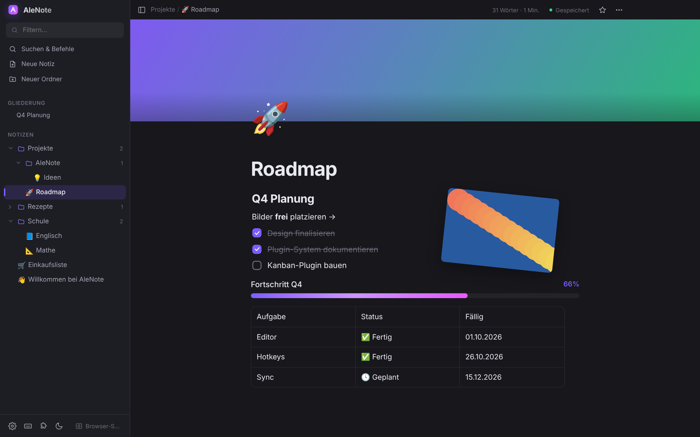
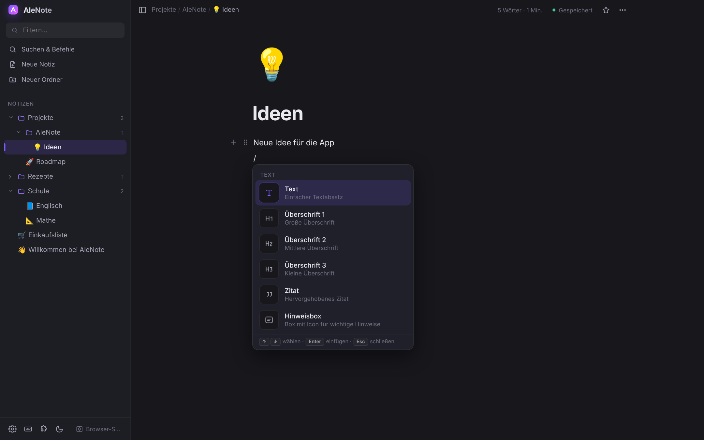
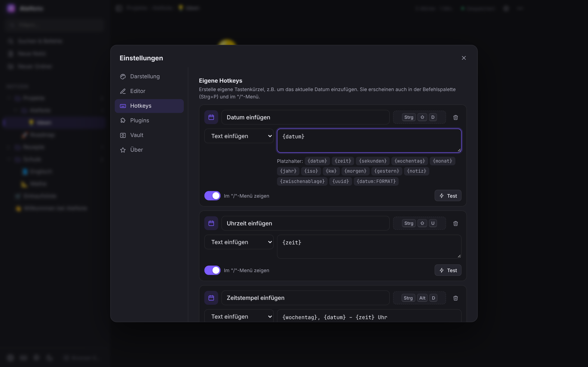
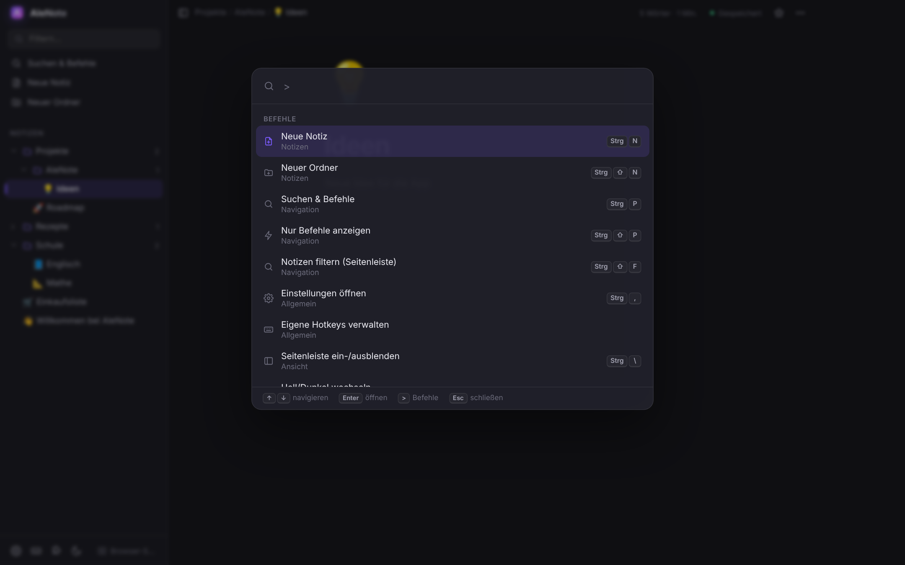
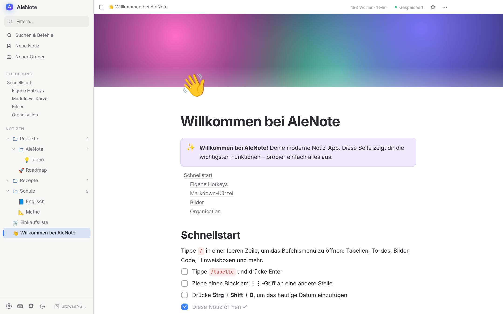
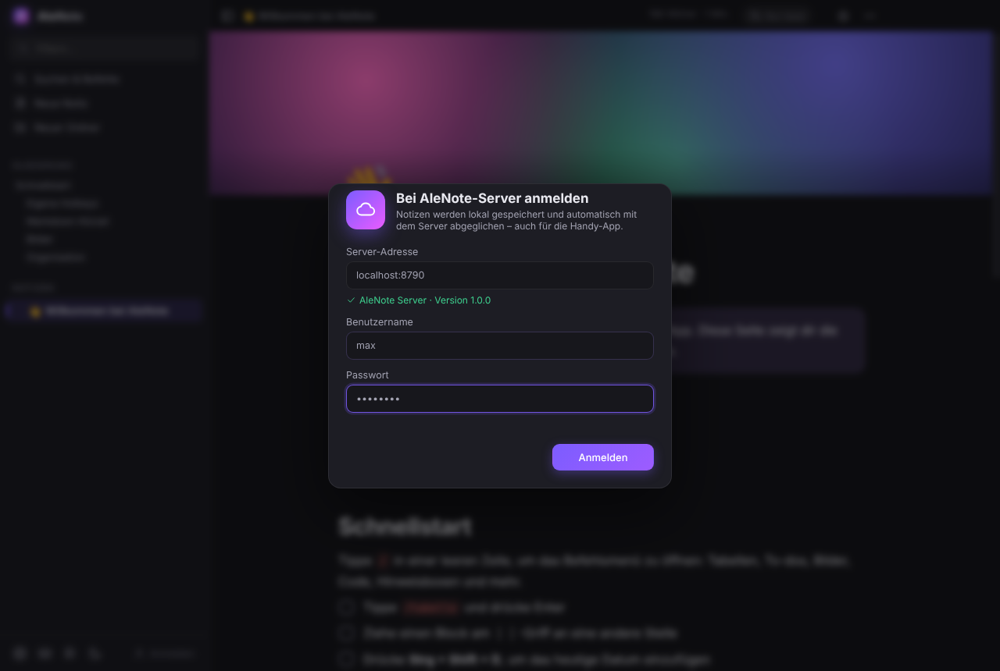
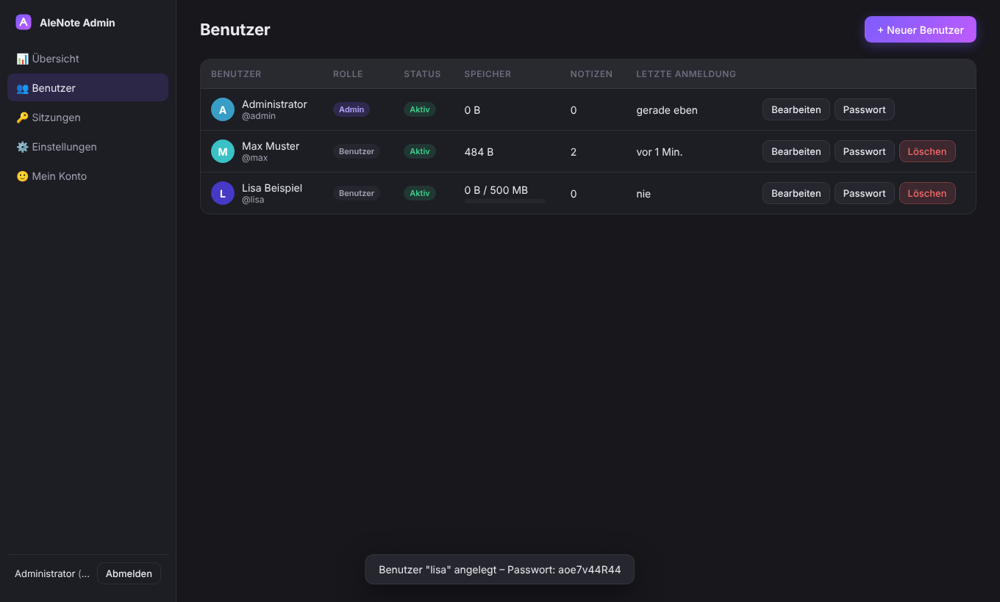

<p align="center">
  
</p>

<h1 align="center">AleNote</h1>

Moderne, erweiterbare Notiz-App für Windows, Android und den Browser (z.B. auf dem Mac) im Stil von Obsidian und Notion.
Basiert auf Electron und reinem JavaScript, ohne Build-Schritt. Jede Datei kann direkt bearbeitet werden.



| | |
|---|---|
|  |  |
|  |  |

## Download

Die fertige Windows-EXE baut GitHub Actions automatisch bei jedem Push.
Zu finden ist sie unter **Actions → Windows-Build → Artifacts**.
Bei einem Tag wie `v1.0.0` landet sie zusätzlich unter **Releases**.

## Starten

| Was | Wie |
|---|---|
| **Entwickeln / Ausprobieren** | [Node.js](https://nodejs.org) installieren, dann `start.bat` doppelklicken (oder `npm install` + `npm start`) |
| **EXE bauen** | `build-exe.bat` doppelklicken. Im Ordner `dist/` liegen danach der Installer und eine portable EXE |

Notizen liegen als Dateien im **Vault** (Standard: `Dokumente\AleNote`). Ordner in der App sind echte Ordner auf der Festplatte.

**Ordner sind auch Seiten**: Ein Klick auf einen Ordner öffnet ihn als Seite, in die du Text schreiben kannst (der Pfeil klappt ihn auf und zu). Der Ordnerinhalt erscheint darin als Unterseiten.

**Unterseiten** (wie in Notion): Jede Seite kann weitere Seiten enthalten – über ＋ neben der Seite in der Seitenleiste, „/Unterseite“ im Text, „＋ Unterseite“ unten auf der Seite oder Strg+Alt+U. Seiten lassen sich auch per Ziehen auf eine andere Seite einsortieren. Gespeichert wird das als Ordner mit gleichem Namen neben der Seite (`Projekt.alenote` + `Projekt/…`); Umbenennen, Verschieben und Papierkorb nehmen die Unterseiten automatisch mit.
Bilder landen in `_assets`. Plugins liegen in `.alenote\plugins`.

## Web-Version (Mac & jeder Browser)

Der AleNote-Server (Docker/Unraid oder `start-server.bat`) liefert AleNote auch als Web-App aus: **`http://<Server>:8787/app/`**.
- Gleiche Oberfläche und Funktionen wie die Windows-App, mit Anmeldung am Server und automatischer Synchronisierung.
- Notizen werden im Browser gespeichert (IndexedDB) und funktionieren auch kurz ohne Verbindung.
- Auf dem Mac gelten ⌘-Kürzel statt Strg. Als App ins Dock: Safari → Ablage → **Zum Dock hinzufügen**.
- Die Web-Version ist immer aktuell, sie kommt beim Öffnen frisch vom Server.
- Nicht im Browser verfügbar: globale Schnellnotiz-Tastenkombination und eigene Plugin-Ordner. Einige Kürzel wie Strg/⌘+N oder Strg/⌘+W reserviert der Browser.

## Server, Konten & Synchronisierung

> **HTTPS:** Der Server lässt sich hinter einen Reverse-Proxy (z.B. Nginx Proxy Manager) stellen, auch unter einem Unterpfad. Bei der Anmeldung reicht die Domain – AleNote probiert HTTPS zuerst und folgt Weiterleitungen. Bestehende Geräte stellen über *Konto-Menü → Server-Adresse ändern* um, ohne neu anzumelden. Anleitung: [unraid/README.md](unraid/README.md#6-https-über-einen-reverse-proxy-empfohlen).

AleNote kann sich mit einem **eigenen AleNote-Server** verbinden (Ordner [`server/`](server/README.md)):

- **Mehrere Benutzer**, jeder mit eigenem, getrenntem Notiz-Speicher
- **Web-Admin-Konsole** unter `http://<server>:8787/admin`: Benutzer anlegen, Rollen, Speicher-Kontingente, Sitzungen, Server-Einstellungen
- **In AleNote anmelden**: unten links auf **Anmelden** klicken, dann Server, Benutzername und Passwort eingeben. Über das Profil-Menü lässt sich auch das **Konto wechseln** oder **abmelden**.
- **Lokal zuerst**: Jede Notiz wird sofort lokal gespeichert, die App funktioniert auch offline. Danach fragt AleNote beim Server nach Änderungen, lädt neue Versionen herunter und eigene Änderungen hoch. Das passiert nach jeder Änderung, alle 30 Sekunden und beim Wechsel ins Fenster.
- **Live-Bearbeitung**: Solange du online bist, erscheinen Änderungen an einer geöffneten Notiz in Sekundenbruchteilen auf deinen anderen Geräten – auch wenn auf mehreren Geräten gleichzeitig geschrieben wird (pro Block gewinnt die letzte Änderung). Oben zeigt ein grünes **Live**-Abzeichen die Verbindung und auf welchen Geräten die Notiz noch offen ist. Offline speichert AleNote wie gewohnt lokal; beim Wiederverbinden werden Offline-Änderungen blockweise zusammengeführt. Abschaltbar unter *Einstellungen → Konto*.
- **Konflikte**: Wurde eine Notiz auf zwei Geräten gleichzeitig geändert, fragt AleNote, welche Version gelten soll: **Meine**, **Server** oder **beide behalten**.
- Jedes Konto hat einen eigenen lokalen Ordner (`Dokumente\AleNote Konten\<benutzer>@<server>`).
- Die [Server-API](docs/API.md) ist dokumentiert und dient als Grundlage für eine **Handy-App**.

| | |
|---|---|
|  |  |

**Unraid:** fertiges Docker-Image `ghcr.io/aleb-roni/alenote-server` samt Template, Anleitung in [`unraid/README.md`](unraid/README.md).

Server starten: `cd server` und `node server.js` (oder `start-server.bat`). Das Admin-Passwort steht beim ersten Start in der Konsole.

## Automatische Updates

Die **installierte** Version (Setup) aktualisiert sich selbst:

- **Mit Server-Konto:** Updates kommen von deinem AleNote-Server (`<server>/updates/`).
- **Ohne Konto:** Updates kommen direkt aus den GitHub-Releases.
- Gesucht wird beim Start und alle 4 Stunden. Neue Versionen werden im Hintergrund geladen, dann erscheint oben **„Update installieren“**. Ohne Klick wird beim Beenden installiert.
- In **Einstellungen → Über** siehst du die Version und kannst manuell suchen oder die Automatik abschalten.

**Neue Version veröffentlichen:** In `package.json` die `"version"` erhöhen (z.B. `1.2.0`) und auf `main` pushen. Alternativ ein Tag `v1.2.0` pushen.

GitHub baut das Setup und erstellt ein Release. Der Server übernimmt es innerhalb von 6 Stunden automatisch, sofort geht es über **Admin-Konsole → App-Updates → „Jetzt bei GitHub prüfen“**. Danach aktualisieren sich alle verbundenen Apps.

Die portable EXE kann sich nicht selbst aktualisieren.

## Funktionen

- **Ordnerstruktur**: Ordner/Unterordner, Notizen per Drag & Drop verschieben, Inline-Umbenennen (F2), Favoriten ★, Rechtsklick-Menüs
- **Block-Editor**: Text, Überschrift 1–3, Aufzählung, nummerierte Liste, To-do, Zitat, Hinweisbox, Aufklappbar, Code, Tabelle, Bild, Trennlinie, Inhaltsverzeichnis, Fortschrittsbalken
- **„/“-Befehle**: In einer Zeile `/` tippen und filtern, z.B. `/tab`, `/code`, `/datum`
- **Markdown-Kürzel**: `#`, `##`, `###`, `-`, `1.`, `[]`, `>`, `!>`, `>>`, ```` ``` ````, `---`
- **Tabellen wie in Excel**:
  - Bereiche markieren (ziehen, Shift+Klick, Shift+Pfeile, Spalten-/Zeilenköpfe).
  - **Ausfüllkästchen** zum Runterziehen: Zahlenreihen, Datum, Wochentage, Monate, „Woche 1 → 2“. Formeln werden angepasst, über das Tabellenende hinaus entstehen neue Zeilen.
  - Strg+D / Strg+R zum Ausfüllen nach unten/rechts. Kopieren/Einfügen von Bereichen, auch aus Excel, und ein Wert auf alle markierten Felder.
  - **Formeln** (`=A1*B1`, `=SUMME(B2:B9)`, MITTELWERT, MIN, MAX, ANZAHL, RUNDEN, WENN …) mit Formelleiste.
  - Sortieren, Summenzeile, Beschriftung A/B/1/2 einblendbar.
- **Freie Tabellen**: per „Frei bewegen“ oder `/Freie Tabelle` überall auf der Seite platzieren (am Griff ziehen, Breite ändern).
- **Zeichnen & Markieren**: Stift-Knopf oben, `/zeichnen` oder Strg+Alt+P (Textmarker: Strg+Alt+M). Stift, Textmarker und Radierer, mit Farben, Stärke und Transparenz (Regler und 25/50/75/100 %). Shift zeichnet gerade Linien, Strg+Z macht Striche rückgängig, Esc beendet den Modus. Die Zeichnungen werden mit der Notiz gespeichert und synchronisiert.
- **Bilder**: Drag & Drop, Strg+V, Größe per Griff ändern, ausrichten, Lightbox (Doppelklick)
- **Frei bewegliche Bilder**: Mit **Shift** ablegen oder „Frei bewegen“ wählen. Dann lassen sie sich verschieben, skalieren (4 Ecken), drehen (Shift = 15°-Schritte) und in Ebenen anordnen. Sie rasten an Mitte und Rändern ein (Alt schaltet das aus).
- **Blöcke**: Am ⋮⋮-Griff ziehen zum Verschieben, Klick öffnet das Menü (Umwandeln, Farbe, Duplizieren, Löschen). Tab/Shift+Tab rückt ein bzw. aus.
- **Formatierungsleiste** bei Textauswahl: Fett, Kursiv, Unterstrichen, Durchgestrichen, Code, Link, Text- und Markerfarbe
- **Befehlspalette** (Strg+P): Notizen, Volltextsuche, alle Befehle (`>` zeigt nur Befehle)
- **Eigene Hotkeys** (siehe unten)
- **Themes**: Dunkel, Mitternacht, OLED, Wald, Hell, Papier, Rosé, dazu Akzentfarbe, Schriftart, Größe, Seitenbreite, Fokus-Modus
- **Rückgängig/Wiederholen** (Strg+Z / Strg+Y), automatisches Speichern
- **KI-Assistent** (Claude, ChatGPT, Gemini, Mistral, Groq, DeepSeek, Grok, OpenRouter, Ollama, Open WebUI, eigene OpenAI-kompatible Server):
  - **Selbst gehostete KI** (Ollama / Open WebUI): Einstellungen → KI → „Open WebUI“ → Adresse (wie im Browser) und API-Schlüssel eintragen → „Modelle laden“ → Modell wählen → „Testen“. Für die Web-Version über HTTPS muss auch die KI über HTTPS erreichbar sein (z.B. über den Reverse-Proxy).
  - **Eigene Prompts** festlegen (Einstellungen → KI): Was soll die KI mit dem Text machen, für welchen Bereich (Auswahl, Block, ganze Seite), ob ersetzen oder darunter einfügen. Optional mit eigenem Kürzel, im „/“-Menü und in der Formatierungsleiste.
  - **Mehrere Blöcke auf einmal**: mit der Maus über mehrere Blöcke ziehen, Shift+Klick (Bereich) oder Strg+Klick (einzelne dazu/weg), auf dem Handy ⋮⋮ → „Mehrere markieren“. Über der Auswahl erscheint eine Leiste mit ✨ KI, Kopieren und Löschen. Strg+J und das Block-Menü gelten dann für alle markierten Blöcke.
  - **KI-Leiste** mit Strg+J, KI-Untermenü am ⋮⋮-Griff jedes Blocks, Vorschau vor dem Übernehmen, alles mit Strg+Z rückgängig.
  - **Chat an der Seite** (✨ oben oder Strg+Shift+J), einklappbar, kennt auf Wunsch die geöffnete Notiz, Antworten lassen sich in die Notiz einfügen.
  - API-Schlüssel bleiben nur auf dem Gerät und werden nicht synchronisiert.
- **Schnellnotiz** (⚡ in der Seitenleiste, Strg+Shift+Space in AleNote, **Strg+Alt+Space überall in Windows**): kleines Fenster, Text eintippen, Enter. Der Eintrag landet mit Datum und Uhrzeit in „Quicknotizen“ oder einer frei wählbaren Notiz, auf Wunsch als To-do mit Fälligkeitsdatum. Einstellungen → Schnellnotiz.
- **Fälligkeitsdatum für To-dos**: im To-do auf 📅 klicken, `/To-do mit Datum` oder Strg+Shift+T. Heute, Morgen oder Überfällig werden farbig markiert.
- **Kalender** (Seitenleiste oder Strg+Alt+K): Monats- und Listenansicht mit allen To-dos des angemeldeten Benutzers. Abhaken, per Ziehen auf einen anderen Tag verschieben, Doppelklick auf einen Tag legt eine Aufgabe an, Klick öffnet die Notiz.
- **Vorlagen**: Notizen im Ordner „Vorlagen“ (Besprechung, Projekt, Wochenplan, Tagesnotiz sind dabei). „Neue Notiz aus Vorlage“ (Strg+Alt+V), `/vorlage` fügt eine Vorlage ein, „Als Vorlage speichern“ im Notiz-Menü. Platzhalter wie `{datum}`, `{wochentag}`, `{kw}` werden ersetzt, auch im Namen.
- **Versionsverlauf** (Strg+Alt+H oder Notiz-Menü): Der Server bewahrt frühere Stände jeder Notiz auf (letzte Stunde alle, dann je 10 Min., Stunde, Tag – 90 Tage). Vorschau, Änderungen farbig vergleichen, wiederherstellen oder als Kopie anlegen.
- **Export & Import**: Notiz als **PDF** oder **Word (.docx)** mit Tabellen, Bildern und Formatierung (Notiz-Menü oder Strg+P). Import von Markdown-Dateien, ganzen **Obsidian**-Vaults und **Notion**-Exporten (ZIP, inkl. CSV-Tabellen und Bildern).
- **KI-Chat diktieren**: Mit dem 🎤-Knopf neben dem Eingabefeld sprichst du deine Frage oder deinen Auftrag ein (gleiche Spracherkennung wie bei der Schnellnotiz). Der Text landet im Eingabefeld; im Kontext-Menü des Chats lässt sich „Nach dem Diktieren gleich senden“ einschalten.
- **KI führt Befehle aus**: Im KI-Chat einfach sagen, was passieren soll – z.B. „mach mir eine To-do-Liste für den Umzug“, „erstelle eine Tabelle mit …“, „leg eine Unterseite Urlaub an“ oder „erinnere mich morgen um 9 an den Zahnarzt“. Die KI legt To-dos (mit Datum und Erinnerung), Tabellen, Seiten und Schnellnotizen an und kann Befehle aus der Befehlspalette ausführen; im Chat steht, was sie gemacht hat (Strg+Z macht Änderungen in der Notiz rückgängig). Löschen und Ähnliches darf sie nicht. Abschaltbar im Chat über das Kontext-Menü („KI darf Befehle ausführen“).
- **Eigene Emojis**: Im Emoji-Fenster auf ＋ klicken und ein Bild hochladen (wird verkleinert und auf alle Geräte synchronisiert). Nutzbar als Seiten-Icon, in Hinweisboxen und im Text über „/Emoji“. Dazu über 800 Emojis mit deutscher Suche („herz“, „kaffee“, „rakete“ …) und „Zuletzt benutzt“.
- **Frag deine Notizen** (Strg+Shift+A): Im KI-Chat „Alle Notizen“ wählen – AleNote sucht die passenden Notizen, die KI antwortet daraus und nennt die Quellen als klickbare Links.
- **Kalender**: Monat, Woche und Liste. **Kalender-Abos** (Google, Outlook, iCloud per iCal-Link) zeigen Termine farbig an, inkl. Wiederholungen. Tagesnotiz für jeden Tag direkt aus dem Kalender. Die Abos werden mit dem Konto auf alle Geräte synchronisiert.
- **Erinnerungen** an To-dos: im To-do auf die Glocke 🔔 tippen und wählen, wann erinnert wird (zur Fälligkeit, 15 Min., 1 Std., 3 Std., 1 Tag, 2 Tage, 1 Woche vorher oder eigener Wert – auch mehrere). Optional an alle To-dos mit Datum. Benachrichtigung zur Uhrzeit (oder zur Standardzeit), Karte mit „Erledigt“ und „Später“, Tagesübersicht beim Start. Auf Android auch bei geschlossener App. Unter Windows optional im Infobereich weiterlaufen und mit Windows starten (Einstellungen → Erinnerungen).
- **Android-Widgets & Schnellzugriff**: Schnellnotiz-Kachel im Quick Panel, Schnellnotiz-Widget (Notiz, Diktieren, Kalender), To-do-Widget zum Lesen und Abhaken, App-Verknüpfungen beim langen Drücken auf das Symbol.
- **Diktieren** (Mikrofon in der Schnellnotiz, `/diktieren`, Strg+Shift+M): Sprache wird per OpenAI/Groq (Whisper) oder Gemini zu Text, die KI bereinigt Satzzeichen und Füllwörter. Im Browser geht ersatzweise die eingebaute Spracherkennung.
- **Papierkorb** (🗑 unten in der Seitenleiste oder Befehl „Papierkorb öffnen“): Gelöschte Notizen und Ordner bleiben 30 Tage erhalten und lassen sich an ihren alten Platz zurücklegen. Direkt nach dem Löschen geht auch „Rückgängig“. Der Papierkorb wird mitsynchronisiert, Wiederherstellen klappt also auch auf einem anderen Gerät. Er liegt im Vault im Ordner `_trash`.
- **Mitgelieferte Plugins**: Wortzähler, Markdown-Export, Tagesnotiz (Strg+Alt+N), Gliederung, Fortschrittsbalken

## Eigene Hotkeys

**Einstellungen → Hotkeys → „Neuer Hotkey“**

1. Einen Namen vergeben, z.B. „Datum einfügen“.
2. In das Kürzel-Feld klicken und die Tasten drücken, z.B. `Strg+Shift+D`.
3. Eine Aktion wählen:
   - **Text einfügen**: Vorlage mit Platzhaltern
   - **Block einfügen**: z.B. eine Tabelle oder ein To-do
   - **Befehl ausführen**: ein beliebiger anderer Befehl

Jeder eigene Hotkey erscheint automatisch in der **Befehlspalette (Strg+P)** und im **„/“-Menü**.
Im „/“-Menü lässt er sich pro Hotkey auch ausblenden.

| Platzhalter | Ergebnis |
|---|---|
| `{datum}` | 26.10.2026 |
| `{zeit}` / `{sekunden}` | 14:05 / 14:05:33 |
| `{wochentag}`, `{monat}`, `{jahr}` | Montag, Oktober, 2026 |
| `{iso}` | 2026-10-26 |
| `{kw}` | Kalenderwoche |
| `{morgen}`, `{gestern}` | Datum ±1 Tag |
| `{notiz}` | Titel der aktuellen Notiz |
| `{zwischenablage}` | Inhalt der Zwischenablage |
| `{datum:FORMAT}` | eigenes Format, z.B. `{datum:dddd, DD. MMMM YYYY}` |

Format-Bausteine: `YYYY` `YY` `MM` `MMMM` `DD` `dddd` `HH` `mm` `ss`

Auch **alle eingebauten Tastenkürzel** lassen sich dort ändern oder entfernen.

Voreingestellt sind: `Strg+Shift+D` Datum · `Strg+Shift+U` Uhrzeit · `Strg+Alt+D` Zeitstempel · `Strg+Shift+Enter` neue Aufgabe.

## Weitere Tastenkürzel

| Kürzel | Aktion |
|---|---|
| Strg+N / Strg+Shift+N | Neue Notiz / Neuer Ordner |
| Strg+P / Strg+Shift+P | Suchen & Befehle / nur Befehle |
| Strg+, | Einstellungen |
| Strg+\ | Seitenleiste ein/aus |
| Strg+Shift+L | Hell/Dunkel |
| F11 | Fokus-Modus |
| Strg+Z / Strg+Y | Rückgängig / Wiederholen (auch per ↶ ↷ oben) |
| Strg+A | 1× Blockinhalt, 2× alle Blöcke markieren (dann Entf, Strg+C, Strg+X) |
| Strg+D | Block duplizieren |
| Strg+Shift+↑/↓ | Block verschieben |
| Strg+Alt+1/2/3/0 | In Überschrift 1/2/3 oder Text umwandeln |
| Strg+Alt+T / Strg+Alt+L | In To-do / Aufzählung umwandeln |
| Strg+Shift+E | Als Markdown exportieren |
| Strg+Alt+N | Tagesnotiz |
| Strg+J / Strg+Shift+J | KI-Befehl / KI-Chat |
| Strg+Shift+Space | Schnellnotiz (global: Strg+Alt+Space) |
| Strg+Alt+K | Kalender |
| Strg+Shift+T | Fälligkeitsdatum festlegen |
| Strg+Alt+V | Neue Notiz aus Vorlage |
| Strg+Alt+H | Versionsverlauf |
| Strg+Shift+A | Frag deine Notizen |
| Strg+Shift+M | Diktieren |
| F12 | Entwicklerwerkzeuge |

## Projektstruktur

```
main.js              Electron-Hauptprozess (Fenster, Dateien, Vault, Protokoll alenote://, Konten)
sync.js              Synchronisierung mit dem AleNote-Server
server/              Sync-Server + Admin-Konsole (eigenständig, ohne Abhängigkeiten)
docs/API.md          Server-API (Grundlage für Handy-App)
preload.js           sichere Brücke zur Oberfläche
src/
  app.js             Start, Layout, Notiz-Verwaltung, eingebaute Befehle, Plugin-API
  themes.js          Farbschemata
  welcome.js         Willkommens-Notiz
  core/
    registry.js      ★ zentrale Registry für Blöcke, Befehle, Themes, Panels, Platzhalter
    hotkeys.js       Tastenkürzel + eigene Hotkeys + Platzhalter
    plugins.js       Plugin-Lader
    events.js        Event-Bus
    api.js           Dateizugriff (mit Browser-Fallback zum Testen)
    utils.js, shortcuts.js, history.js
  blocks/            eingebaute Blocktypen (text.js, table.js, media.js)
  builtin-plugins/   eingebaute Plugins (gute Vorlagen!)
  ui/                editor, sidebar, palette, settings, slashmenu, toolbar, floats, pickers, overlays, icons
  styles/app.css     gesamtes Design + Animationen
```

## Features hinzufügen

Am einfachsten geht es mit einem **Plugin**. Dafür gibt es zwei Wege:

- **Eingebaut**: Eine Datei in `src/builtin-plugins/` anlegen und in `src/builtin-plugins/index.js` eintragen.
- **Ohne den Code anzufassen**: `<Vault>\.alenote\plugins\mein-plugin\plugin.js` anlegen, dann Strg+R.

```js
export default {
  id: 'mein-plugin',
  name: 'Mein Plugin',
  description: 'Was es macht',
  activate(app) {
    // Befehl (Befehlspalette + Tastenkürzel)
    app.registerCommand({
      id: 'mein.hallo', name: 'Hallo sagen', icon: 'zap', shortcut: 'Ctrl+Alt+H',
      run: () => app.toast('Hallo!')
    });

    // Eintrag im "/"-Menü
    app.registerSlashCommand({
      id: 'mein.signatur', name: 'Signatur', icon: '✍️', group: 'Eigene',
      run: () => app.insertText('Viele Grüße\nAle')
    });

    // Neuer Blocktyp
    app.registerBlock({
      type: 'warnung', name: 'Warnung', icon: '⚠️', group: 'Text', text: true,
      create: () => ({ text: '' }),
      render: (block, ctx) => {
        const el = app.ui.editable(block, { placeholder: 'Achtung…' });
        el.style.color = 'var(--c-red)';
        return el;
      },
      toMarkdown: (b) => '⚠️ ' + app.ui.htmlToMarkdown(b.data.text)
    });

    // Platzhalter für eigene Hotkeys: {wetter}
    app.registerVariable({ name: 'wetter', description: 'Wetter', value: () => 'sonnig ☀️' });

    // Theme
    app.registerTheme({ id: 'mein-theme', name: 'Mein Theme', dark: true, vars: { '--bg': '#101418', /* ... */ } });

    // Ereignisse
    app.on('note:save', (note, path) => console.log('gespeichert', path));
  }
};
```

**Ereignisse:** `app:ready`, `note:open`, `note:change`, `note:save`, `tree:change`, `settings:change`, `theme:change`, `editor:render`

**Block-API:** `render(block, ctx)` gibt ein HTML-Element zurück.
Felder mit `data-field="name"` werden automatisch in `block.data.name` gespeichert.
`ctx.update(patch, { rerender })` ändert Daten, `ctx.editor` ist der Editor, `ctx.insertAfter(type)` fügt einen Block danach ein.
Optional gibt es noch `markdown: /^regex/` für Markdown-Kürzel, `onKeyDown(e, ctx, el)` und `continues: true`, damit Enter denselben Typ erzeugt.

Weitere Ideen für Plugins: Kanban-Board, Kalender, Verlinkung zwischen Notizen (`[[...]]`), Mathe-Formeln, Synchronisation, Passwortschutz.
